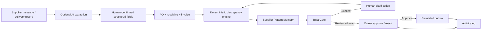

# Vortex OrderGuard — Judge Demo Guide

This guide describes the implemented competition prototype on the `vortex-orderguard-mvp` branch. All demo records are synthetic.

## One-sentence pitch

**OrderGuard catches supplier discrepancies before they become expensive mistakes, remembers repeated issue patterns, and keeps every consequential action behind a human-controlled Trust Gate.**

## Why this is more than a chatbot

OrderGuard uses AI only where unstructured language creates friction: optional extraction of item, quantity, unit and unit price from a supplier message. A human must confirm those extracted fields.

The important business decisions are deterministic and explainable:

- quantity comparison;
- price comparison;
- invoice quantity comparison;
- incompatible-unit blocking;
- money-at-risk calculation;
- repeated issue detection for the same supplier + item;
- owner-only approval;
- duplicate-action protection;
- audit logging.

AI does not decide whether a supplier is good or bad, does not approve actions, and does not calculate the payable amount.

## Architecture



## Best 3-minute demo flow

### 1. Discrepancy case

From the dashboard, click **1 · Discrepancy**.

Synthetic evidence:

- Supplier: FreshFarm Foods
- PO: Chicken, 10 kg at RM12/kg
- Received: 8 kg
- Invoice: 10 kg at RM13/kg

OrderGuard should show:

- Quantity mismatch
- Price mismatch
- Received × agreed price = RM96
- Invoice amount = RM130
- Difference / money at risk = RM34
- Trust Gate = REVIEW
- Owner approval required

Do not approve yet if you want to demonstrate Pattern Memory next.

### 2. Repeat issue intelligence

Return to the dashboard and click **2 · Repeat issue**.

This creates another FreshFarm Foods + Chicken exception. The case should now show:

- **Repeat issue detected**
- previous exception count;
- recurring discrepancy types;
- current-case money at risk;
- owner resolution playbook.

Important explanation for judges: Pattern Memory is not a supplier score or blacklist. It only surfaces repeated evidence for the same supplier and item so the owner can notice a recurring operational problem.

### 3. Ambiguous unit safety case

Return to the dashboard and click **3 · Ambiguous unit**.

The receiving record says `2 bags`, while the PO/invoice use `kg`.

OrderGuard must not guess a conversion. The Trust Gate should be **BLOCKED**. Enter a human-confirmed quantity and unit, then click **Confirm & recalculate**. Only after the data becomes comparable can the workflow move to owner review.

## Optional clean-match demo

Click **4 · Clean match** to show that OrderGuard does not create unnecessary alerts or supplier actions when all records match.

## Innovation points to say in the pitch

1. **Human-controlled automation:** the system can prepare an action, but only the owner can approve a consequential step.
2. **Trust Gate:** ambiguity blocks the workflow instead of allowing AI or rules to guess.
3. **Supplier Pattern Memory:** repeated exception evidence becomes visible across cases without automatically judging or penalising the supplier.
4. **Money at Risk:** the dashboard converts operational discrepancies into an immediately understandable RM impact signal.
5. **Explainable by design:** every flag is linked to source values and a deterministic rule.
6. **SME reusable:** the same exception workflow can support restaurants, retail shops, cafes and other small businesses with configurable item/unit mappings.

## Safety and scope boundaries

- Synthetic data only in the competition demo.
- No real payment processing.
- No real supplier message is sent; the outbox is simulated.
- No automatic supplier blacklist or risk label.
- No legal, tax or financial advice.
- AI extraction is optional and has a manual fallback.
- API keys must remain in Replit Secrets or server-side environment variables.

## Current automated checks

The core test suite covers:

- matching records;
- quantity and price discrepancies;
- incompatible-unit clarification;
- Trust Gate blocking;
- human clarification and recalculation;
- owner-only approval;
- rejection without supplier action;
- duplicate approval protection;
- repeat issue detection;
- supplier separation in pattern memory;
- open money-at-risk aggregation.

Use:

```bash
python -m unittest discover -s tests -v
```
